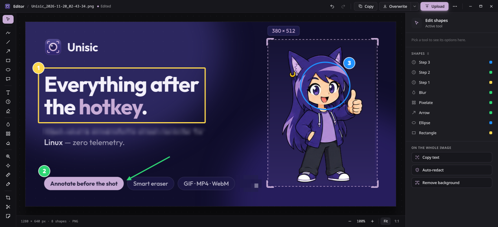
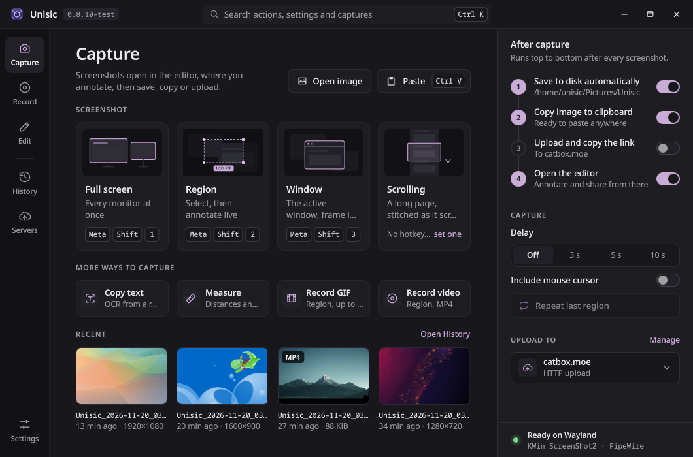
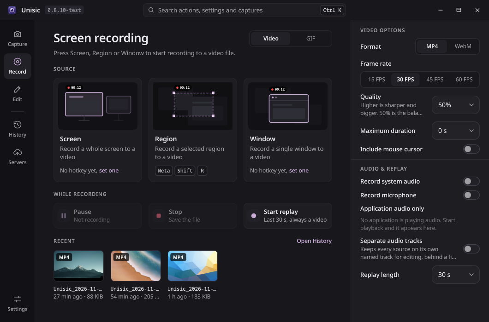
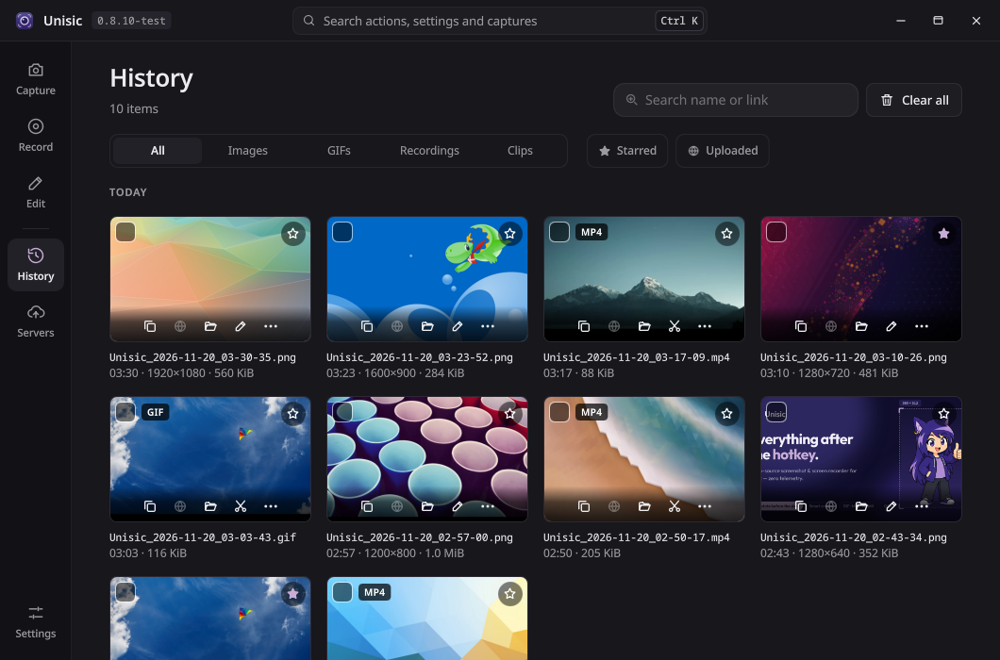
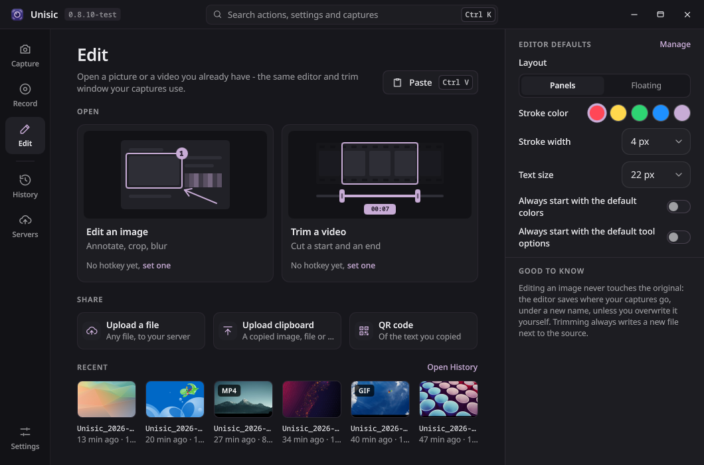

<div align="center">


# Unisic

### Most snipping tools stop at a screenshot.<br />Unisic is everything that should happen after.

Draw on the selection before the shot is taken · polish it in the editor · record the same region as a GIF or video · read the text out of the pixels · paste the link. On Wayland, silently, with zero telemetry.

**[unisic.app](https://unisic.app)** · **[Documentation](https://unisic.app/docs)** · **[Discord](https://discord.gg/U2Eyw6xQBz)**

[](https://github.com/unisic/unisic/releases/latest)

<p>
  
  <a href="https://github.com/unisic/unisic/releases/latest"></a>
  <a href="https://github.com/unisic/unisic/releases"></a>
  
  <a href="https://discord.gg/U2Eyw6xQBz"></a>
</p>

[](https://ko-fi.com/unisic)

<br />







</div>

## What it does

- **Capture**: full screen, a region, the active window, or a scrolling page taller than the screen. Draw arrows, shapes, text, blur and numbered steps on the selection before the shot is taken.
- **Edit**: crop, highlight, pixelate, magnifier, spotlight, stickers, rotate, resize, remove the background on your own computer, and more.
- **Record**: a region, the full screen or a window as GIF, MP4 or WebM, with system and microphone sound.
- **Instant replay**: keep the last seconds, or up to an hour, of the screen and save them with one key. It can start with Unisic or only while a game runs (Steam, GameMode). Cut the clip in the trim window: remove parts, crop it to vertical or square, scale it, name it.
- **Read**: copy the text out of any region (OCR) or scan a QR code or barcode. On Linux the text is read by PaddleOCR, shipped with Unisic, for Latin-script languages and Chinese; Tesseract covers the other scripts.
- **Share**: upload to your own HTTP server, ShareX `.sxcu` destinations, FTP/SFTP, S3 or a built-in host. The link can be copied for you (on by default).
- **Remember**: a history of every capture, themes and a translated interface.

Built for **Linux Wayland** on the system's own APIs (xdg-desktop-portal, KWin ScreenShot2, PipeWire). KDE Plasma gets the silent native path, GNOME and wlroots desktops go through the portals ([compositor support](https://unisic.app/docs/compositors)). No telemetry, no account. The only thing Unisic does online by itself is check GitHub for a new release (and download it, where Unisic updates itself), and one switch turns that off ([privacy policy](PRIVACY.md)).

## Install

```sh
curl -fsSL https://unisic.app/install.sh | bash
```

A menu opens. The recommended entry installs the self-updating AppImage in `~/.local`, with no password. The other entry installs your distribution's package (`.deb`, Fedora `.rpm`, Arch, openSUSE). The same menu updates, uninstalls and turns automatic updates on or off. Every download is checked against the SHA-256 published with the release.

Prefer to do it by hand? Take the AppImage or a package from the **[latest release](https://github.com/unisic/unisic/releases/latest)**, or follow the [installation docs](https://unisic.app/docs/installation) for COPR, Debian/Ubuntu, openSUSE, Arch and Nix repositories.

## Hotkeys

| Keys | Action |
| --- | --- |
| <kbd>Meta</kbd> + <kbd>Shift</kbd> + <kbd>1</kbd> | Capture the full screen |
| <kbd>Meta</kbd> + <kbd>Shift</kbd> + <kbd>2</kbd> | Capture a region |
| <kbd>Meta</kbd> + <kbd>Shift</kbd> + <kbd>3</kbd> | Capture the active window |
| <kbd>Meta</kbd> + <kbd>Shift</kbd> + <kbd>G</kbd> | Record a GIF (region) |
| <kbd>Meta</kbd> + <kbd>Shift</kbd> + <kbd>R</kbd> | Record video (region) |
| <kbd>Meta</kbd> + <kbd>Shift</kbd> + <kbd>T</kbd> | Copy text out of a region (OCR) |
| <kbd>Ctrl</kbd> + <kbd>Esc</kbd> | Stop recording (fixed emergency stop) |

Change them in Settings → Hotkeys. The same actions run from a terminal or a compositor keybind: `unisic --region`, `--fullscreen`, `--window`, `--scroll`, `--gif` (all options in `unisic --help` and the [CLI docs](https://unisic.app/docs/configuration#command-line-interface)).

<details>
<summary><b>X11 (best effort)</b></summary>

<br />

Screenshots, the editor, OCR, history and uploads work as on Wayland. Recording grabs frames from the X server, so it works even without a portal, and hotkeys use `XGrabKey`. Recording a single **window** needs Wayland (the window picker comes from the portal); record the screen or a region instead. Daily use is on Wayland and X11 was checked once on one desktop, so please [report](https://github.com/unisic/unisic/issues) what breaks, with your desktop and window manager.

</details>

<details>
<summary><b>Windows (experimental)</b></summary>

<br />

The Windows port is written entirely by AI. The author will not touch the code it takes to port Unisic to a system this poorly thought out, so everything Windows-specific, from the capture and recording paths to the installer and the CI that tests it, was written by an AI model and checked by running it, not written by hand.

On Windows 11, screenshots, the editor, OCR, the tray, hotkeys and recording a GIF or video of the screen or a region (with sound) work, and so does the scrolling capture. Recording a window records the area of the active window (the one you clicked last), so keep the window in place while recording. OCR uses the recognizer built into Windows, with Tesseract as the fallback. "Remove background" is not available there. Each [release](https://github.com/unisic/unisic/releases) has a setup wizard (`unisic-<version>-windows-x64-experimental-setup.exe`) and a portable zip (`Unisic-<version>-windows-x86_64-experimental.zip`, run `bin\unisic.exe`). Neither needs administrator rights, and both update themselves.

Windows keeps <kbd>Win</kbd> + <kbd>Shift</kbd> with digits and most letters for itself, so the defaults move:

| Keys | Action |
| --- | --- |
| <kbd>Ctrl</kbd> + <kbd>Shift</kbd> + <kbd>Print</kbd> | Capture the full screen |
| <kbd>Print</kbd> or <kbd>Ctrl</kbd> + <kbd>Print</kbd> | Capture a region |
| <kbd>Alt</kbd> + <kbd>Print</kbd> | Capture the active window |
| <kbd>Win</kbd> + <kbd>Shift</kbd> + <kbd>G</kbd> | Record a GIF (region) |
| <kbd>Shift</kbd> + <kbd>Print</kbd> | Record video (region) |
| <kbd>Win</kbd> + <kbd>Shift</kbd> + <kbd>O</kbd> | Copy text out of a region (OCR) |
| <kbd>Ctrl</kbd> + <kbd>Alt</kbd> + <kbd>Esc</kbd> | Stop recording (fixed emergency stop) |

A bare <kbd>Print</kbd> opens the Snipping Tool until you turn off Settings → Accessibility → Keyboard → "Use the Print screen key to open screen capture"; <kbd>Ctrl</kbd> + <kbd>Print</kbd> always works. To uninstall, use Settings > Apps for the setup wizard's copy, or delete the unpacked folder. Settings and history stay in `%APPDATA%\Unisic` and `%LOCALAPPDATA%\Unisic`.

</details>

<details>
<summary><b>Build from source</b></summary>

<br />

Needs **Qt 6.5+** (with QtWayland, the GUI private headers and Linguist tools), CMake, Ninja, PipeWire, Tesseract + Leptonica, zxing-cpp, LayerShellQt, KF6GuiAddons, libinput, plasma-wayland-protocols and the X11 development packages.

```sh
cmake -B build -G Ninja -DCMAKE_BUILD_TYPE=Release
cmake --build build && ./build/unisic
```

Every dependency is required: configure stops and names a missing package. The one exception is ONNX Runtime, for PaddleOCR and background removal (Linux only), loaded only when used. Package lists for Fedora, Debian/Ubuntu and Arch are in [CONTRIBUTING.md](CONTRIBUTING.md#building).

</details>

## Code signing policy

Free code signing provided by [SignPath.io](https://about.signpath.io), certificate by [SignPath Foundation](https://signpath.org).

- Committers and reviewers: [Members of the unisic organization](https://github.com/orgs/unisic/people)
- Approvers: [Owners](https://github.com/orgs/unisic/people?query=role%3Aowner)

The Windows binaries are built by GitHub Actions from this repository ([.github/workflows/windows.yml](.github/workflows/windows.yml)).

Privacy policy: This program will not transfer any information to other networked systems unless specifically requested by the user or the person installing or operating it, apart from the automatic update check described in [PRIVACY.md](PRIVACY.md), which can be turned off.

## Contributing

Issues and pull requests welcome. For a bug, [file an issue](https://github.com/unisic/unisic/issues) with your desktop, compositor, GPU and logs. [CONTRIBUTING.md](CONTRIBUTING.md) has the project layout. Unisic is developed with agentic AI assistance ([AGENTS.md](AGENTS.md)); every generated change is read line by line and reviewed by the maintainer before it lands.

Licensed **GNU GPL v3** - see [LICENSE](LICENSE) and [what that means](https://unisic.app/docs/introduction#license). The sticker art is [Twemoji](https://github.com/jdecked/twemoji) by Twitter and the Twemoji contributors, CC BY 4.0 ([third_party/twemoji](third_party/twemoji/LICENSE)), and their names and groups come from Unicode's emoji data and CLDR, under the [Unicode License v3](third_party/twemoji/LICENSE.unicode). Built by [@DeBondor](https://github.com/DeBondor) & [@D3anDark](https://github.com/D3anDark), inspired by [ShareX](https://getsharex.com/) and [Spectacle](https://apps.kde.org/spectacle/).

<div align="center">
<br />


*Uni approves this capture.*

</div>
